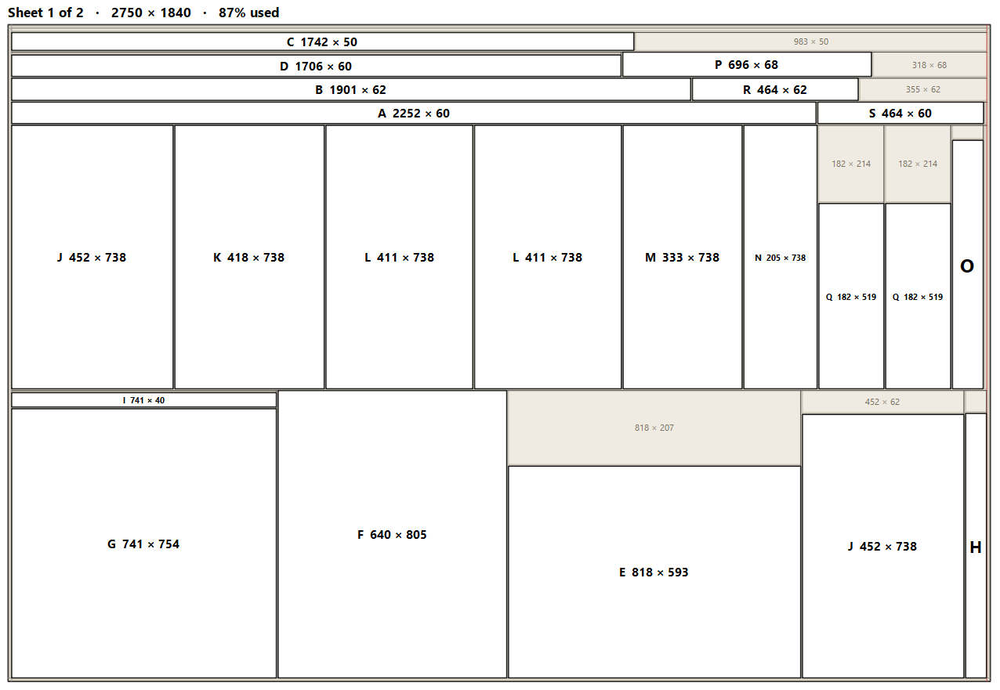

# Cut List para IngeTrazo — guia de uso

*Também em [English](user-guide.md) e [Español](user-guide.es.md).*
Para a versão 0.1.0, IngeTrazo 0.5.9.

O Cut List transforma um modelo de móvel na lista de peças a cortar,
envia essa lista para o fornecedor que corta as suas chapas e desenha os
planos de corte para a sua própria serra.

## 1. Instalar

1. Baixe `cutlist-0.1.0.zip` na página de
   [Releases](https://github.com/ronaldogalves/cutlist-ingetrazo/releases)
   — ou instale o **Cut List** pelo gerenciador de extensões do IngeTrazo.
2. À mão: no IngeTrazo, **Extensões ▸ Abrir pasta de plugins**,
   descompacte ali, de modo que a pasta tenha `cutlist/__init__.py`, e
   reinicie o IngeTrazo.

O Cut List aparece como uma aba no painel lateral e em **Extensões ▸ Cut
List**.

## 2. Como modelar para a lista de corte

- **Uma peça, um grupo ou componente.** Cada chapa cortada é um grupo ou
  componente próprio. Um armário pode ser um grupo com as suas peças
  dentro; o Cut List lê as peças de dentro (os grupos mais internos são
  as peças).
- **Dê nome às peças.** O nome é o que a oficina vê. Peças sem nome
  aparecem como "Grupo #1", "Grupo #2"… e guardam o seu número.
- **Pinte as faces, não só as peças.** O Cut List lê o modelo como o
  marceneiro pinta: o material das faces grandes é a chapa, um material
  diferente numa face é laminado ou lâmina, um material numa borda
  estreita é fita de borda.
- **Etiquetas** podem deixar coisas fora da lista (paredes,
  eletrodomésticos): use o botão **Etiquetas** no painel.

## 3. Primeiro uso: o que entra na lista

Na primeira vez em que você clica em **Atualizar**, o Cut List pergunta o
que ler: a seleção ou o modelo inteiro, grupos simples também ou só
componentes, e quais etiquetas deixar de fora. Marque "não mostrar de
novo" e ele lembra; mude depois em **Ajustes…**.

## 4. Materiais: diga uma vez o que cada um é

Abra **Materiais…**. À esquerda, todos os materiais encontrados nas
peças; à direita, o que ele é:

| O que é | Significa |
|---|---|
| **Chapa** | a chapa que é cortada (MDF, compensado, MDP…) |
| **Revestimento** | laminado, fórmica ou lâmina colada numa face |
| **Fita de borda** | fita numa borda |
| **Só aparência** | uma textura que só mostra algo (a borda do compensado) |
| **Ignorar** | não se corta: vidro, ferragens, paredes |

Para uma **chapa** você também pode definir:

- **Espessuras** em que ela vem (ex.: `15; 18`): uma peça modelada com
  14 mm numa chapa de 15 mm é então marcada *espessura fora da lista*.
- **Chapas em que vem**: o tamanho real da chapa, não refilado. Um
  tamanho só para algumas espessuras vai na última coluna (ex.: `3; 6`).
  **Modelos ▾** salva tamanhos com um nome e os aplica a vários materiais
  de uma vez — selecione-os antes com Ctrl+clique.
- **Serra** e **refilo**, quando esta chapa precisa de outros que não os
  padrões.
- **Sobremedida de corte**: toda peça desta chapa é cortada maior nesta
  medida, para levar à medida depois. O modelo mantém a medida acabada.

Para uma **fita de borda**:

- **Espessura** e **largura** (ex.: 0,45 e 22 mm), e a **folga para
  acabamento** (2 mm por padrão, somando os dois lados): uma peça mais
  grossa que largura − folga é marcada *fita estreita demais* — uma fita
  de 22 mm serve até 20 mm. Crie uma fita por largura que você usa (22,
  30…) e pinte a certa.
- **Sobremedida** por borda (a sobra refilada depois de colar),
  **perda %** e o **comprimento do rolo** se você compra em rolos — tudo
  opcional.
- **Cortar a chapa menor pela espessura da fita**: para fitas grossas; a
  serra recebe a medida menor, a lista mantém a acabada.

"Usar estes materiais também nos meus outros modelos" (marcado) os põe
na sua biblioteca: todo modelo com um material do mesmo nome parte dela.
Na lista, *minha biblioteca* e *só neste modelo* dizem de onde vem cada
configuração; *não configurado* é um material ainda por decidir.

## 5. Lendo a lista

As peças são agrupadas por **chapa e espessura**; peças iguais são uma
linha com quantidade. Colunas: **Peça** (a letra, a mesma dos planos de
corte), nome, quantidade, comprimento, largura, espessura, **bordas** com
fita (C1/C2 as compridas, L1/L2 as curtas, vistas da face 1), **faces**
(revestimentos) e **notas**.

**Precisa de atenção** lista o que o Cut List não adivinha: peças que não
são retangulares, várias chapas fundidas num só grupo, peças sem
material, acabamentos não configurados, espessuras fora da lista. Nada
some em silêncio; **Excluídas** lista o que você ou um material deixou de
fora.

**Fitas de borda** no fim: os metros de cada fita a comprar, quantas
bordas e os rolos, quando definidos.

Clique numa linha para ver as peças destacadas no modelo.

## 6. Ajustes da peça

Clique com o botão direito numa linha (ou em peças no modelo) ▸ **Ajustes
da peça…**: veio no comprimento ou na largura, se pode girar na chapa,
deixar fora da lista, inverter a face 1, uma nota, a **sobremedida de
corte** da própria peça e os valores dos seus campos personalizados. Cada
mudança é um passo de desfazer.

**Campos personalizados** (cliente, ambiente…) são definidos em
**Ajustes…**: um valor para o modelo, regras por etiqueta ou um valor por
peça.

## 7. Exportar para um fornecedor

**Exportar…** grava a lista do jeito que o seu fornecedor quer. Um
**perfil** guarda todas as regras: colunas e a sua ordem, cabeçalho,
separador, codificação, unidades, arredondamento, nomes de arquivo.
Perfis prontos:

- **CorteCloud** — copie para a área de transferência e cole na janela de
  importação do CorteCloud (ou abra o arquivo do Excel e cole de lá).
- **Leo Madeiras** — um CSV para a importação no site da Leo.
- **Simple CSV** — para todo o resto.

Mude um perfil e **Salvar**, ou **Salvar como…** um novo; **Importar…**
aceita vários arquivos de perfil de uma vez, **Exportar perfil…**
compartilha um. A prévia mostra exatamente o que será gravado; problemas
(um código de fornecedor faltando, um caractere que a codificação do
arquivo não aceita) são listados e travam a exportação até serem
corrigidos. Desmarque chapas para deixá-las fora desta exportação.
"Também um arquivo com as fitas de borda a comprar" grava os totais de
fita junto da lista.

## 8. Planos de corte

**Planos…** distribui cada chapa nas suas folhas para uma seccionadora ou
serra de bancada. Chapas sem tamanho são perguntadas uma vez (Cancelar
para tudo).

- **Chapas** à esquerda, com folhas e quanto é aproveitado.
- **A serra**: primeiros cortes no comprimento, na transversal (mais
  fácil quando se corta sozinho) ou o melhor dos dois; 2, 3 ou 4 etapas
  de corte; espessura da serra; refilo nas quatro bordas ou em duas.
  **Refazer o plano** aplica.
- **Sobras da oficina**: pedaços que você já tem, usados antes das
  chapas inteiras e nunca refilados.

Nas chapas:

- **Passe o mouse sobre uma peça**: a sua medida e os cortes que a
  liberam, cada um com a distância para pôr na guia; ela também acende no
  modelo. Peças selecionadas no modelo acendem no plano.
- **Passe o mouse sobre um corte**: a etapa, a distância da guia e o
  comprimento. Um primeiro corte atravessa a chapa inteira, então
  qualquer um deles pode ser o primeiro — para dividir uma chapa grande
  em duas antes do resto.
- **Botão direito numa peça**: trocar o veio (todas as cópias, ou só
  esta), permitir ou proibir girar, ajustes da peça, deixar fora deste
  plano, mostrar no modelo. Uma mudança na peça é um passo de desfazer, e
  o plano é refeito para as mesmas peças.

## 9. Imprimir

Escolha o papel (A4, Carta), o tamanho do texto (**Grande**, ou
**Compacto** para menos páginas), se chapas iguais aparecem uma vez só
(×n), uma página de totais, posições dos cortes na borda, os cortes em
ordem sob cada chapa ("1 Longitudinal 645 · 2 Transversal 1982…": onde pôr
a guia, a partir da borda do pedaço que está sendo cortado); depois
**PDF…** ou **SVG…**. Toda página diz "Página n de N" com o modelo, a
chapa e a data, para que folhas espalhadas na oficina possam ser
reordenadas.

## 10. Salvar um plano

**Salvar plano…** guarda o plano no modelo (salvo junto com o arquivo).
**Planos salvos ▾** o reabre exatamente como era — mesmo que a
distribuição saísse diferente hoje. Se o modelo mudou desde então, a
janela diz quais peças mudaram de medida ou sumiram, e **Refazer o plano
para estas peças** as distribui de novo.

## 11. Bom saber

- As medidas nas janelas são digitadas em milímetros; a lista segue as
  unidades do modelo, salvo o que for definido em **Ajustes…**.
- Madeira maciça é listada mas ainda não distribuída; os planos são para
  serra, não para nesting de CNC.
- Arquivos `.skp` chegam ao IngeTrazo sem a hierarquia de grupos, e
  grupos e componentes não ficam separados: confira *Precisa de atenção*.
- Dúvidas, erros e perfis para outros fornecedores:
  [github.com/ronaldogalves/cutlist-ingetrazo](https://github.com/ronaldogalves/cutlist-ingetrazo/issues).
